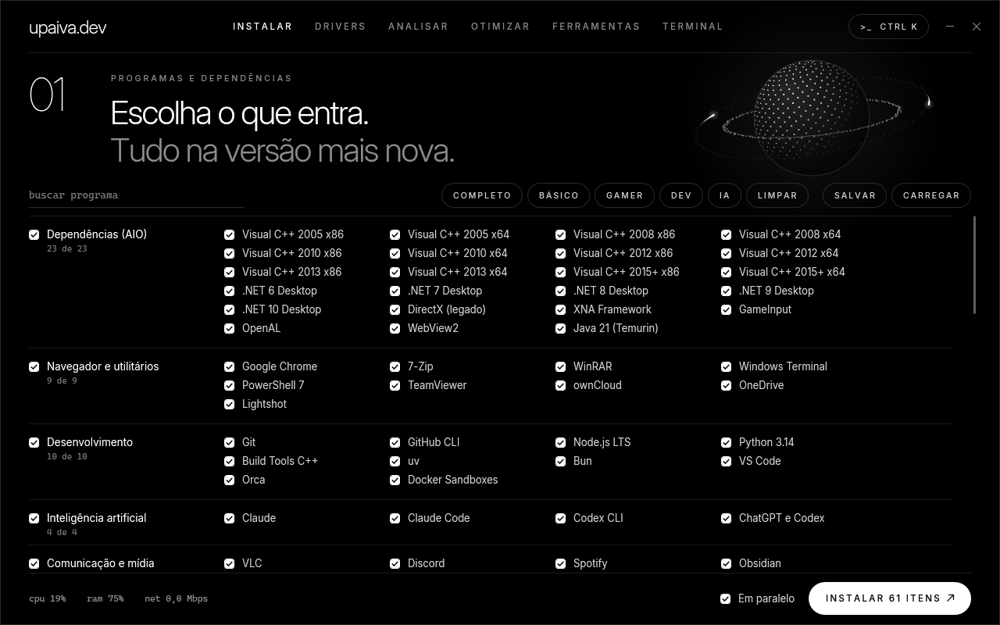
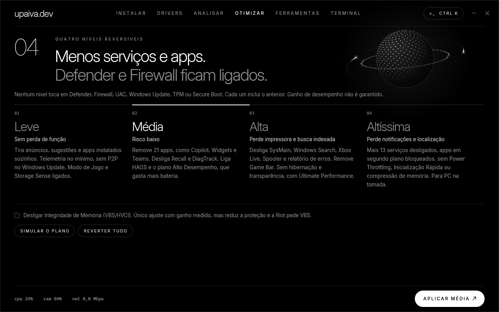
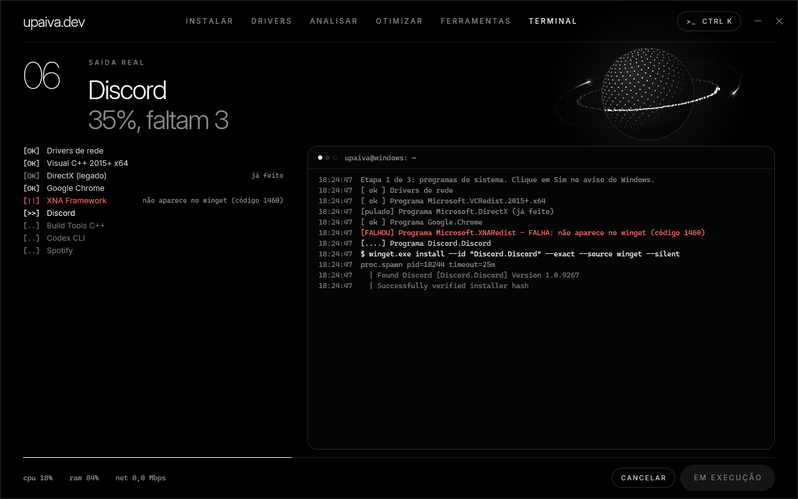
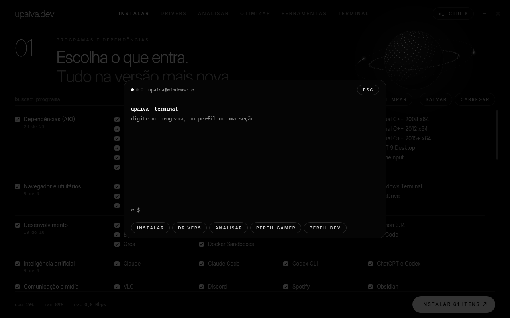
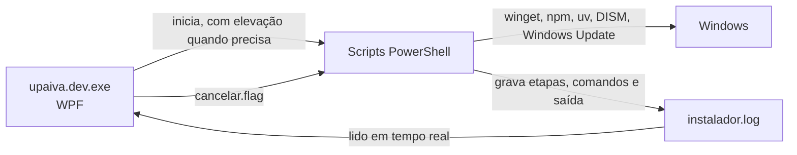

<div align="center">

# upaiva.dev

### Do Windows recém-formatado ao PC pronto para trabalhar.
**Programas, dependências, drivers, segurança e otimização em um único app, com cada comando à vista.**


[Baixar](../../releases/latest) · [Recursos](#recursos) · [Stack](#stack) · [Compilar](#compilar) · [Status](#status)



</div>

## Formatar não precisa custar o dia inteiro

Depois de formatar, começa a parte chata: baixar dezenas de instaladores, lembrar de cada runtime, caçar drivers, refazer configurações e torcer para o jogo não reclamar de uma DLL. Os otimizadores prometem milagres e escondem o que fazem.

O **upaiva.dev** troca isso por uma tela. Você escolhe o que entra, acompanha o comando real de cada etapa e sai com um relatório do que funcionou e do que não funcionou.

| | |
|---|---|
| **Tudo em um lugar** | Dependências, programas, skills, drivers, análise de segurança, otimização e manutenção |
| **Sempre a versão mais nova** | Instala por winget, npm e uv na hora, em vez de guardar instaladores velhos |
| **Nada escondido** | Comando, PID, código de saída e tempo de cada etapa aparecem no terminal embutido |
| **Retoma de onde parou** | Rodou de novo? Só refaz o que faltou. Cancelou? O que foi interrompido não conta como feito |
| **Reversível** | Ponto de restauração, plano simulado e backup do estado anterior antes de otimizar |
| **Leve de verdade** | Um `.exe` de 106 KB, sem runtime extra: usa o .NET e o PowerShell que já vêm no Windows 11 |

## Recursos

### Instalar
**24 dependências estilo AIO** (Visual C++ de 2005 em diante, .NET, DirectX, XNA, PhysX, OpenAL, Java, WebView2), programas essenciais e um **catálogo opcional com 102 itens**, incluindo assistentes de IA, modelos locais, editores com agentes, DevOps, criação e jogos.

- **Busca instantânea** por nome ou categoria
- **Perfis prontos:** Completo, Básico, Gamer, Dev e IA, além de salvar e carregar a sua seleção
- **Fila visível** com o estado e o tempo de cada item
- **Progresso ponderado:** um pacote pesado conta mais que um utilitário pequeno
- **Instalação simultânea:** até 4 programas juntos, conforme os núcleos do PC e enquanto CPU e RAM têm folga. Instaladores MSI esperam a vez, porque o Windows só roda um por vez
- **Cancelar a qualquer momento**, encerrando também os processos filhos

### Drivers
Busca no **catálogo oficial do Windows Update**, aponta dispositivos com erro e drivers antigos, cria um ponto de restauração e instala só o que você marcar. Para placas de vídeo, leva direto ao fabricante. Sem banco de drivers de terceiros.

Também lista os **componentes de jogos** que faltam ou têm versão nova: Visual C++, .NET e .NET Framework 3.5, DirectX, XNA, PhysX, OpenAL, Java e outros. Eles vêm do winget e da Microsoft, e cada um pode ser desmarcado antes de instalar.

### Analisar
Varredura **somente leitura** de segurança e saúde: Defender, Firewall, UAC, Secure Boot, TPM, VBS, proteção LSA, SMBv1, RDP, BitLocker, portas abertas, programas de inicialização, discos, travamentos e atualizações. Nada muda sem você marcar.

### Otimizar



| Nível | Para quem | Custo |
|---|---|---|
| **Leve** | Qualquer PC: tira anúncios, sugestões e apps instalados sozinhos | Nenhuma função perdida |
| **Média** | Remove 21 apps, Recall e DiagTrack, e liga HAGS e Alto Desempenho | Mais consumo de bateria |
| **Alta** | Desliga SysMain, Windows Search, Xbox Live e Spooler | Sem impressora e sem busca indexada |
| **Altíssima** | Quase 90 serviços a mais desligados e apps em segundo plano bloqueados. Fica só o que rede, áudio, login, loja, segurança e jogos usam | Sem localização, sensores, smart card e Miracast. Para PC na tomada |

Os níveis são cumulativos, somam mais de 170 ações no topo e podem ser **simulados antes de aplicar**. A Altíssima usa uma lista fechada de serviços do Windows, com detecção de Bluetooth e rede móvel, e uma lista de intocáveis que aborta o plano antes de qualquer alteração se houver conflito. Serviços de terceiros, como GPU, Vanguard, Steam e VPN, nunca são tocados.

### Ferramentas
**Preparar formatação:** antes de formatar, salva ao lado do app os dados do PC, a lista de programas e de apps da Loja, os drivers e, se você marcar, as redes Wi-Fi. A instalação usa tudo isso depois, e no fim a rotina mostra o que **não** foi copiado. Os drivers completos ficam só guardados, sem instalar sozinhos.

Atualizar todos os programas; **limpar disco** (temporários, Lixeira, cache do Windows Update, componentes antigos via DISM, logs, miniaturas e cache dos navegadores, com confirmação e o espaço liberado à vista); reparar o sistema com DISM e SFC; resetar a rede; criar ponto de restauração; e **reinstalar pela Microsoft Store os apps removidos**.

> A limpeza age só em arquivos descartáveis e no seu cache. Não mexe no registro de execução do sistema (Amcache, Shimcache, BAM, USN Journal, Event Log) — isso não é limpeza de disco e serve só para esconder o que rodou na máquina.

### Terminal e Ctrl K



<sub>Tela com dados de demonstração.</sub>

A saída real de cada processo, com a órbita do planeta acendendo na proporção do progresso. E, como no [site](https://upaiva.dev), **`Ctrl K`** abre um terminal que encontra programas, perfis e seções sem tirar as mãos do teclado.



## O que ele se recusa a fazer

Confiança vale mais que um número bonito na tela.

- **Nenhum nível desliga** Defender, Firewall, UAC, SmartScreen, Windows Update, TPM ou Secure Boot.
- **Não promete FPS.** Desligar VBS/HVCI é o único ajuste com ganho medido por testes independentes, e por isso fica à parte, desmarcado e com aviso.
- **Não usa banco de drivers de terceiros** nem Windows modificado.
- **Não leva logins nem histórico.** Tokens, `.env`, conversas, logs e projetos ficam fora do pacote, e o gerador de configurações para se encontrar algo com formato de segredo. A única exceção é o Wi-Fi em Preparar formatação: vem desmarcado, avisa que as senhas ficam em texto puro na pasta do app, e a instalação apaga os arquivos ao importar. Eles nunca entram no repositório nem na release.
- **Decoração não finge ser status.** Comandos e telemetria de CPU, RAM e rede são reais, e a órbita só acende com progresso real.

## Stack

| Camada | Tecnologia | Por quê |
|---|---|---|
| Interface | WPF, XAML | Nativo, com renderização por hardware e sem navegador embutido |
| Linguagem | C# 5 | Compila com o `csc.exe` que já vem no Windows, sem SDK |
| Runtime | .NET Framework 4.8 | Já presente no Windows 11 |
| Motor | PowerShell 5.1 | O único shell garantido em um Windows recém-instalado |
| Pacotes | winget, npm, uv, Microsoft Store | Sempre a versão publicada mais recente |
| Drivers | Windows Update Agent (COM) | Fonte oficial da Microsoft |
| Tipografia | Inter, Inter Display, Cascadia Mono | A identidade do [upaiva.dev](https://upaiva.dev) |
| Gráficos | `DrawingContext` | Planeta de partículas e letter-spacing próprios, sem bibliotecas |



A interface não executa nada sozinha: ela inicia os scripts e acompanha o log. Assim, um erro de tela não derruba uma instalação em andamento, e o pedido de cancelamento alcança também os processos elevados, por meio de um arquivo que os dois lados enxergam.

## Como usar

1. Baixe o pacote da [última release](../../releases/latest) e extraia.
2. Abra `INSTALADOR\upaiva.dev.exe` com dois cliques, **sem** "Executar como administrador". O Windows pede permissão na hora certa.
3. O app não tem assinatura digital. Se o Windows avisar, use **Mais informações > Executar assim mesmo**.

O app precisa da pasta ao lado dele: `scripts`, `fonts`, `config`, `binarios` e `pacotes`.

## Compilar

Não precisa instalar SDK nenhum:

```powershell
powershell -ExecutionPolicy Bypass -File build\compilar.ps1
copy dist\upaiva.dev.exe INSTALADOR\
```

```text
app/            Interface: ui.xaml e app.cs
build/          compilar.ps1
docs/           Capturas de tela
INSTALADOR/     O que o .exe usa em execução
  scripts/      Instalar, drivers, analisar, otimizar, ferramentas, restaurar configs
  config/       Snapshot de skills e configurações do Claude e do Codex
  fonts/        Inter (licença OFL)
  binarios/     Binários grandes, só na release
  pacotes/      Bundle offline do winget, só na release
```

## Status

| | |
|---|---|
| **Testado de ponta a ponta** | Compilação, análise real, busca real de drivers, simulação da Altíssima, restauração das configs em pasta temporária, travas contra rodar no PC de origem e todo o fluxo da interface, incluindo o cancelamento e o escalonador da instalação simultânea, com instalador de teste |
| **Falta testar em máquina real** | Instalação real dos programas, instalação de drivers, aplicar e reverter níveis, instalação simultânea com instaladores reais, correções da análise, ferramentas, reinstalação de apps e cancelamento em processo elevado |

O ganho de desempenho dos níveis não foi medido. Na Altíssima, a maior parte dos serviços da lista já fica parada até ser chamada, então espere pouco ganho e confira na simulação o que muda no seu PC.

> `INSTALADOR/config` traz o snapshot de skills e configurações do autor, sem logins nem tokens. Para usar o app com as suas, troque essa pasta.

---

<div align="center">

Feito por **Mateus Paiva** · [upaiva.dev](https://upaiva.dev)

<sub>Fontes Inter sob a licença SIL Open Font. Marcas citadas pertencem aos seus donos.</sub>

</div>
